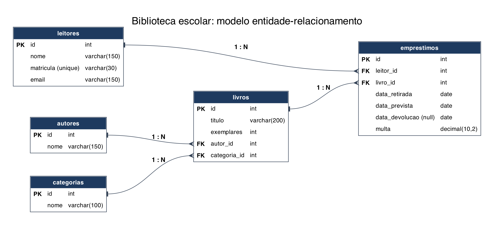

# API da Biblioteca

API REST em NestJS que substitui a planilha de empréstimos de uma biblioteca escolar. Guarda livros, autores, categorias, leitores e empréstimos em SQLite, via TypeORM.

## Como rodar

Requisito: Node.js 22 ou mais novo.

```bash
npm install
cp .env.example .env
npm run start:dev
```

A API sobe em `http://localhost:3000`.

### Banco de dados

O banco é SQLite, então não há servidor para instalar. O arquivo é criado sozinho na primeira execução e os dados continuam lá depois de reiniciar a API.

| Variável do `.env` | O que define | Se ficar vazia |
| --- | --- | --- |
| `PORT` | Porta da API | `3000` |
| `DB_DATABASE` | Caminho do arquivo do banco | `data/biblioteca.sqlite` |

O SQLite não usa usuário nem senha, por isso o `.env` não guarda credenciais. O `.env` fica fora do Git.

### Dados de exemplo

```bash
npm run seed
```

**Atenção:** este comando apaga tudo o que está no banco antes de inserir os dados de exemplo.

## Testando as requisições

O arquivo `requests.http` tem um caso de sucesso por endpoint e um caso para cada regra de R1 a R6. O status esperado está no título de cada requisição. Abra no VS Code com a extensão REST Client.

Os ids do arquivo contam com um banco recém-populado, então rode `npm run seed` e execute as requisições na ordem.

## Endpoints

| Método | Rota | O que faz | Sucesso | Erros |
| --- | --- | --- | --- | --- |
| GET | `/livros` | Lista os livros. Filtros: `?categoria=<id>`, `?autor=<id>`, `?disponivel=true` | 200 | 400 |
| GET | `/livros/:id` | Detalhe do livro, com autor e categoria | 200 | 400, 404 |
| POST | `/livros` | Cadastra um livro | 201 | 400, 404 |
| PATCH | `/livros/:id` | Altera dados do livro | 200 | 400, 404 |
| DELETE | `/livros/:id` | Remove o livro | 204 | 400, 404, 409 |
| GET | `/autores` | Lista os autores | 200 | |
| POST | `/autores` | Cadastra um autor | 201 | 400 |
| GET | `/categorias` | Lista as categorias | 200 | |
| POST | `/categorias` | Cadastra uma categoria | 201 | 400 |
| POST | `/leitores` | Cadastra um leitor | 201 | 400, 409 |
| GET | `/leitores/:id/emprestimos` | Empréstimos do leitor. Filtro: `?status=aberto` ou `?status=devolvido` | 200 | 400, 404 |
| POST | `/emprestimos` | Registra um empréstimo. Corpo: `livroId`, `leitorId` | 201 | 400, 404, 409 |
| PATCH | `/emprestimos/:id/devolucao` | Registra a devolução | 200 | 400, 404, 409 |

## Formato das respostas

Sucesso:

```json
{ "sucesso": true, "dados": { "id": 7, "titulo": "Dom Casmurro" } }
```

Erro:

```json
{
  "sucesso": false,
  "erro": { "status": 409, "codigo": "SEM_EXEMPLAR", "mensagem": "Livro 7 sem exemplar disponível" },
  "caminho": "/emprestimos",
  "timestamp": "2026-11-03T14:05:00.000Z"
}
```

O `DELETE /livros/:id` responde 204, que por definição do HTTP não tem corpo.

## Regras de negócio

| Regra | Onde fica | Se for violada |
| --- | --- | --- |
| R1. Só empresta se houver exemplar disponível | `EmprestimosService` | 409 `SEM_EXEMPLAR` |
| R2. Leitor tem no máximo 3 empréstimos em aberto | `EmprestimosService` | 409 `LIMITE_EMPRESTIMOS` |
| R3. Data prevista é a retirada + 14 dias, calculada pela API | `EmprestimosService` | |
| R4. Atraso gera multa de R$ 1,00 por dia, salva no empréstimo | `EmprestimosService` | |
| R5. Empréstimo devolvido não pode ser devolvido de novo | `EmprestimosService` | 409 `JA_DEVOLVIDO` |
| R6. Livro com empréstimo em aberto não pode ser excluído | `LivrosService` | 409 `LIVRO_COM_EMPRESTIMO_ABERTO` |

Excluir um livro sem empréstimo em aberto também apaga os empréstimos já devolvidos desse livro.

## Modelo de dados



Substantivos do cenário que viraram entidades: livro, autor, categoria, leitor e empréstimo. "Exemplar" virou o atributo `exemplares` do livro, porque a API só precisa saber quantos existem. As datas e a multa são atributos do empréstimo.

| Relacionamento | Cardinalidade | FK |
| --- | --- | --- |
| Autor escreve livros | 1:N | `livros.autor_id` |
| Categoria agrupa livros | 1:N | `livros.categoria_id` |
| Livro tem empréstimos | 1:N | `emprestimos.livro_id` |
| Leitor faz empréstimos | 1:N | `emprestimos.leitor_id` |

### Por que o empréstimo é uma entidade própria?

Porque o empréstimo tem dados próprios que não cabem em uma simples ligação N:N: data de retirada, data prevista, data de devolução e multa. O mesmo leitor pode pegar o mesmo livro várias vezes, e cada vez precisa ser um registro separado, com seu próprio id. As regras de exemplares disponíveis, limite por leitor e multa dependem de consultar e atualizar cada empréstimo individualmente.

## Arquitetura

Um módulo por assunto em `src/`: `livros`, `autores`, `categorias`, `leitores` e `emprestimos`, cada um com controller, service e repository. O que é compartilhado fica em `src/comum/`: middleware de log, filtro de exceções, interceptor de resposta e exceção base.

`LivrosModule` importa `AutoresModule` e `CategoriasModule`. `EmprestimosModule` importa `LivrosModule` e `LeitoresModule`. Por isso a rota `GET /leitores/:id/emprestimos` fica no módulo de empréstimos: colocá-la em leitores criaria uma dependência circular.

## Testes

```bash
npm test
npm run test:e2e
```

Os testes e2e usam um banco SQLite em memória e não tocam no arquivo de dados.
